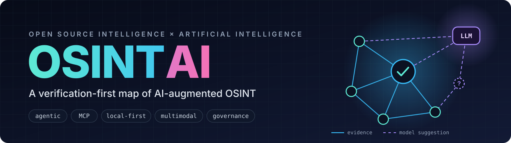
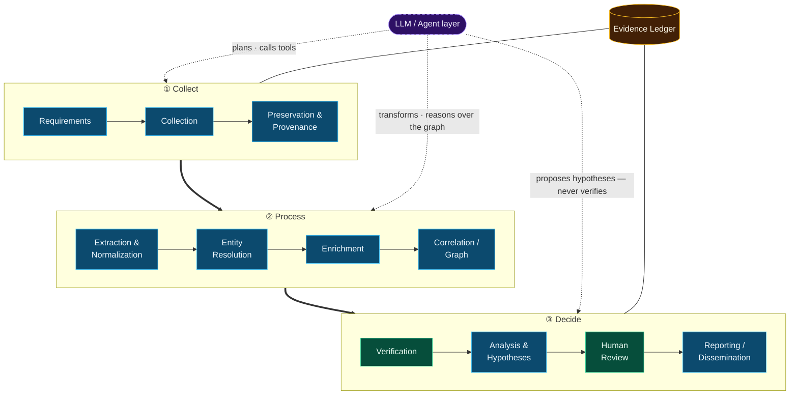
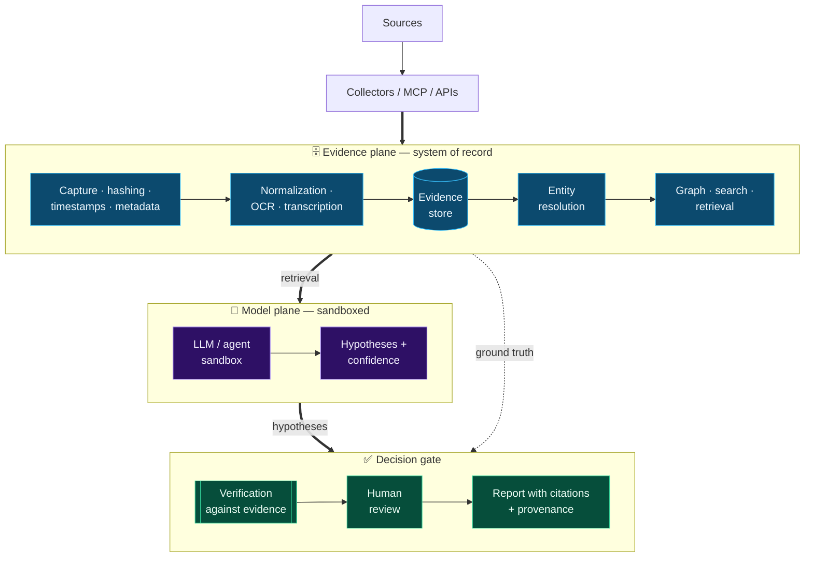

<p align="center">
  
</p>

<!-- osintai:badges:start -->
<p align="center">
  <a href="https://github.com/Ridd1kulusC0d3r/OSINTAI/actions/workflows/validate-catalog.yml"></a>
  
  
  
  
</p>
<!-- osintai:badges:end -->

<p align="center">
  <b>An auditable map of the OSINT + AI ecosystem</b><br>
  agentic investigation · MCP ecosystems · local-first workflows · evaluation · governance · OSINT on AI infrastructure
</p>

<p align="center">
  <a href="#-start-here">Start here</a> &nbsp;·&nbsp;
  <a href="#-the-osintai-model">Model</a> &nbsp;·&nbsp;
  <a href="#-ecosystem-catalog">Catalog</a> &nbsp;·&nbsp;
  <a href="#-paradigms">Paradigms</a> &nbsp;·&nbsp;
  <a href="#-documentation">Docs</a> &nbsp;·&nbsp;
  <a href="#-contributing">Contribute</a>
</p>

> [!IMPORTANT]
> **Rule zero — an LLM response is not evidence.**
> Evidence must remain traceable to a **source**, an **acquisition event** and an **analyst decision**.

---

## 📊 At a glance

<!-- osintai:stats:start -->
| **25** | **23** | **13** | **9** | **16** | **5** | **5** | **4** |
|:---:|:---:|:---:|:---:|:---:|:---:|:---:|:---:|
| tools & platforms | verified | local-first | speak MCP | research records | paradigms | training resources | curated collections |
<!-- osintai:stats:end -->

## 🧭 Why this repository exists

OSINT is rapidly absorbing LLMs, agents, multimodal models, graph reasoning, local inference and MCP tool ecosystems. The useful part is real. The hype is also very real. OSINTAI exists to keep the two apart:

| ✅ OSINTAI keeps… | ❌ …separate from |
|---|---|
| tools that actually exist | claims that merely circulate |
| collection | analysis |
| model output | evidence |
| automation | autonomy |
| AI-assisted investigation | OSINT *against* AI infrastructure |
| an operationally defensible workflow | an "interesting demo" |

Built for **analysts, investigators, CTI teams, researchers and builders** who need to know what is real, how it works and how far it can be trusted.

## 🚀 Start here

Pick the row that sounds like you and follow it left to right.

| If you are… | Read first | Then |
|---|---|---|
| 🔎 **Analyst / investigator** | [Taxonomy](docs/taxonomy.md) | [Learning path](docs/learning-path.md) → [Governance](docs/governance.md) |
| 🛠️ **Builder** | [Reference architecture](docs/reference-architecture.md) | [MCP security](docs/mcp-security.md) → [Evaluation framework](docs/evaluation-framework.md) |
| 🛡️ **CTI / defender** | [AI infrastructure OSINT](docs/ai-infrastructure-osint.md) | [Specialized domains](docs/specialized-domains.md) → [Verification notes](docs/verification-notes.md) |
| 🎓 **Researcher** | [Paradigms](docs/paradigms.md) | [Emerging sources](docs/emerging-intelligence-sources.md) → [Research anchors](#-research-anchors) |
| 🤖 **Automating / using an LLM** | [`catalog/*.json`](catalog/) | [`schemas/`](schemas/) → [`validate_catalog.py`](scripts/validate_catalog.py) |

## 🧩 The OSINTAI model

The intelligence cycle stays in charge. The model layer **assists** specific steps — it never owns the evidence.



<sub>🟦 intelligence cycle &nbsp; 🟩 verification & human control &nbsp; 🟪 model layer (dashed = suggestions only) &nbsp; 🟨 evidence ledger</sub>

## 🏗️ Reference architecture

A defensible OSINT + AI stack separates the **evidence plane** (system of record) from the **model plane** (sandboxed reasoning). Every hypothesis has to come back and be checked against stored evidence.



Full design: **[docs/reference-architecture.md](docs/reference-architecture.md)**

## 🗺️ Core areas

| | Area | What OSINTAI maps |
|:---:|---|---|
| 🤖 | **Agentic OSINT** | planning, tool orchestration, multi-step investigations, human-in-the-loop |
| 🔌 | **MCP for OSINT** | MCP servers, tool exposure, trust boundaries, least privilege |
| 🏠 | **Local-first AI** | Ollama/local models, private inference, sensitive-case isolation |
| 🎞️ | **Multimodal OSINT** | image, video, OCR, audio, document and geospatial analysis |
| 🕸️ | **Graph & entity intelligence** | entity extraction, resolution, knowledge graphs, relationship reasoning |
| ✔️ | **Verification** | source triangulation, provenance, factuality, media verification |
| ⚙️ | **Automation** | monitoring, ingestion, enrichment, reporting and alerting |
| 🛰️ | **OSINT for AI systems** | exposed AI services, public model/service metadata, AI supply-chain intelligence |
| 📏 | **Evaluation** | reproducibility, hallucination measurement, provenance, security and cost |
| ⚖️ | **Governance** | privacy, proportionality, human oversight, evidence handling, AI risk |

## 🌊 Paradigms

Since v0.3, OSINTAI tracks not only tools but the **architectural shifts changing OSINT practice** ([`catalog/paradigms.json`](catalog/paradigms.json)).

| Paradigm | Core shift |
|---|---|
| 🤖 **Autonomous & Agentic OSINT** | models plan, call bounded tools and iterate over evidence |
| 🏠 **Local-First & Zero-API** | inference and data remain analyst-controlled; external dependencies are minimized |
| 🔭 **Emerging-Source Intelligence** | previously ignored sources become structured intelligence |
| 🎞️ **Continuous Multimodal Intelligence** | video, imagery, audio, GEOINT and text are processed as ongoing streams |
| 🕸️ **Decentralized Intelligence Networks** | intelligence exchange and validation move into peer-to-peer or mesh architectures |

Deep dives: [Paradigms](docs/paradigms.md) · [Emerging intelligence sources](docs/emerging-intelligence-sources.md)

## 📚 Ecosystem catalog

Every tool and platform in [`catalog/tools.json`](catalog/tools.json), grouped by role. Click a name to open its canonical source.

<sub>✅ verified &nbsp; 🧪 candidate &nbsp; 🏠 local-first by design &nbsp; — not local-first (may still offer a local model option)</sub>

<!-- osintai:tools:start -->
#### 🤖 Agentic & orchestration platforms

Models plan, call bounded tools and iterate over evidence.

| Project | Focus | Architecture | Local-first | Protocols | Status |
|---|---|---|:---:|:---:|:---:|
| [OpenOSINT](https://github.com/OpenOSINT/OpenOSINT) | `agentic-osint` `mcp` `tool-orchestration` | `tool-calling-agent` `cli` | — | MCP | ✅ verified |
| [Argus OS](https://github.com/AXRoux/argus-os) | `agentic-osint` `tool-orchestration` | `planner-agent` `adapter-framework` | — | — | ✅ verified |
| [Argus — Local-First OSINT Framework](https://github.com/cotcollective/argus) | `agentic-osint` `local-first` `zero-api` | `tool-calling-agent` `cli` | 🏠 | MCP | ✅ verified |
| [FETIH](https://github.com/MustafaKemal0146/fetih) | `agentic-security` `osint` `automation` | `autonomous-agent` `multi-agent` | — | MCP | ✅ verified |
| [Unburden](https://github.com/ghostvyle/Unburden) | `agentic-security` `osint` `mcp` | `autonomous-agent` `mcp-client` | 🏠 | MCP | ✅ verified |
| [The Big Brother](https://github.com/chadi0x/TheBigBrother) | `osint-suite` `threat-intelligence` `dual-use` | `web-ui` `modular-suite` | — | — | ✅ verified |

#### 🔌 MCP servers & tool fabrics

OSINT sources and utilities exposed to assistants through MCP.

| Project | Focus | Architecture | Local-first | Protocols | Status |
|---|---|---|:---:|:---:|:---:|
| [osint-mcp-server](https://github.com/badchars/osint-mcp-server) | `mcp` `infrastructure-osint` `tool-fabric` | `mcp-server` | 🏠 | MCP | ✅ verified |
| [osint-mcp](https://github.com/rjn32s/osint-mcp) | `mcp` `tool-fabric` `agentic-osint` | `mcp-server` `tool-wrapper` | 🏠 | MCP | ✅ verified |
| [MCP DadosBR](https://github.com/cristianoaredes/mcp-dadosbr) | `mcp` `brazil` `public-data` | `mcp-server` | 🏠 | MCP | ✅ verified |
| [GreyNoise MCP Server](https://github.com/GreyNoise-Intelligence/greynoise-mcp-server) | `threat-intelligence` `mcp` `infrastructure-intelligence` | `mcp-server` | — | MCP | ✅ verified |

#### 🏠 Local-first & evidence pipelines

Collection, extraction and correlation on analyst-controlled infrastructure.

| Project | Focus | Architecture | Local-first | Protocols | Status |
|---|---|---|:---:|:---:|:---:|
| [OSINTai](https://github.com/gs-ai/OSINTai) | `local-first` `crawler` `evidence-analysis` | `cli` `pipeline` | 🏠 | — | ✅ verified |
| [Taranis AI](https://github.com/taranis-ai/taranis-ai) | `collection` `situational-awareness` `reporting` | `pipeline` `analyst-workflow` | 🏠 | — | ✅ verified |
| [PANO](https://github.com/ALW1EZ/PANO) | `graph-analysis` `timeline` `multimodal` | `desktop` `graph` | 🏠 | — | ✅ verified |
| [Focal Harvest](https://github.com/techno-neighbour/focal-harvest) | `research` `monitoring` `collection` | `cli` `pipeline` | — | — | ✅ verified |
| [AIL Framework](https://github.com/ail-project/ail-framework) | `unstructured-data` `threat-intelligence` `dark-web-research` | `pipeline` `crawler` | — | — | ✅ verified |
| [IntelHub](https://addons.mozilla.org/firefox/addon/intelhub/) | `browser-osint` `local-first` `ai-assistant` | `browser-extension` `local-agent` | 🏠 | — | ✅ verified |

#### 🎯 Specialized investigation domains

Dark web, SOCMINT, GEOINT, search-based discovery, military and criminal intelligence.

| Project | Focus | Architecture | Local-first | Protocols | Status |
|---|---|---|:---:|:---:|:---:|
| [Robin](https://github.com/apurvsinghgautam/robin) | `dark-web-osint` `research-assistant` `mcp` | `cli` `web-ui` | — | MCP | ✅ verified |
| [OWASP Social OSINT Agent](https://github.com/bm-github/owasp-social-osint-agent) | `socmint` `multimodal` `agentic-osint` | `autonomous-agent` `web-ui` | — | — | ✅ verified |
| [WorldView](https://github.com/Hunter5Thompson/OSINT) | `geoint` `situational-awareness` `multi-agent-rag` | `multi-agent` `rag` | 🏠 | — | ✅ verified |
| [Banshee-AI](https://github.com/Vulnpire/Banshee-AI) | `search-based-osint` `reconnaissance` `automation` | `cli` `pipeline` | — | — | ✅ verified |
| [Theosight](https://www.eos-applications.com/) | `military-osint` `structured-intelligence` `commercial` | `analyst-workflow` `local-llm` | 🏠 | — | ✅ verified |
| [Deep Research Investigator (DRI)](https://www.s2w.inc/en/solutions/decision-ai) | `criminal-intelligence` `dark-web-intelligence` `agentic-investigation` | `domain-agent` `knowledge-graph` | — | — | ✅ verified |

#### 🕸️ Decentralized & experimental

Mesh / peer-to-peer intelligence networks and unaudited research claims.

| Project | Focus | Architecture | Local-first | Protocols | Status |
|---|---|---|:---:|:---:|:---:|
| [ShadowBroker / InfoNet](https://github.com/brockmisner/shadowbroker) | `situational-awareness` `decentralized-intelligence` `geoint` | `real-time-dashboard` `agent-channel` | 🏠 | — | ✅ verified |
| [NovBase-VTX](https://huggingface.co/NovBase-VTX) | `swarm` `local-first` `research-project` | `multi-agent` `swarm` | 🏠 | — | 🧪 candidate |
| [Starcom](https://starcom.app/) | `decentralized-intelligence` `osint` `web3` | `3d-dashboard` `decentralized-network` | — | Nostr, IPFS | 🧪 candidate |
<!-- osintai:tools:end -->

> [!TIP]
> Narrative, role-by-role view: [docs/ecosystem-v0.2.md](docs/ecosystem-v0.2.md) · Claims that were **kept out** and why: [docs/verification-notes.md](docs/verification-notes.md)

## ✔️ Verification levels

OSINTAI does **not** treat every discovered project as equally trustworthy.

| Level | Meaning |
|---|---|
|  | canonical repository/source inspected; description is grounded in that source |
|  | project appears to exist, but claims still need deeper validation |
|  | useful historical reference; inactive or superseded |
|  | claim could not be substantiated or was materially misleading |

## 💡 What makes OSINTAI different

1. **Verification-first curation** — ambiguous or unsupported claims are quarantined instead of promoted.
2. **Human + machine readable** — Markdown for analysts, JSON + schema for automation and LLM retrieval.
3. **Evidence-centric architecture** — provenance is a first-class component, not a reporting afterthought.
4. **Benchmark mindset** — projects can be evaluated on reproducibility, factuality, provenance and agent safety.
5. **Security-aware agent design** — prompt injection, tool misuse and MCP supply-chain risks are part of the model.
6. **Privacy-aware workflows** — data minimization and case sensitivity influence architecture and model placement.
7. **Dual perspective** — AI can assist OSINT, and AI infrastructure itself can become an OSINT subject.

## 📖 Research anchors

Primary sources and high-quality research, from [`catalog/research.json`](catalog/research.json) — including the 2026 taxonomy of agentic/generative AI for OSINT, the NIST AI RMF Generative AI Profile, the Berkeley Protocol, New America's OSINT Privacy Impact Framework and the OWASP Top 10 for Agentic Applications 2026.

<details>
<summary><b>Show all research records</b></summary>

<!-- osintai:research:start -->
| Year | Reference | Type |
|:---:|---|---|
| 2026 | [A Multimodal Large Language Model Approach for Cross-modal Alignment of Remote Sensing Imagery and Open Source Intelligence](https://eurekamag.com/research/098/677/098677480.php) 🧪 | conference paper candidate |
| 2026 | [Agentic and Generative AI for Open-Source Intelligence and Cyber Investigations: Taxonomy, Evaluation, Challenges, and Future Directions](https://arxiv.org/abs/2607.03233) | preprint survey |
| 2026 | [Arquitectura modular de flujos automatizados con LLM y OSINT en n8n para aplicaciones de ciberseguridad](https://zenodo.org/records/18508499) | conference proceedings |
| 2026 | [Automated MITRE ATT&CK Technique Classification Using OSINT and Advanced NLP](https://doi.org/10.70917/ijcisim-2026-4916) | journal article |
| 2026 | [Breadcrumbs in the Digital Forest: Tracing Criminals through Torrent Metadata with OSINT](https://arxiv.org/abs/2601.01492) 📄 | preprint |
| 2026 | [MOSAIV: Multi-Agent LLM Swarms for Automated Multimedia News Verification: Fake News Detection](https://doi.org/10.1145/3805622.3812607) | conference paper |
| 2026 | [PromptINT: Using Prompt Leaks as a New Source of OSINT Intelligence](https://www.youtube.com/watch?v=76iQJMgrXco) | summit talk methodology |
| 2026 | [The Cognitive Fingerprint: LLM-Resistant Cross-Domain Threat Actor Attribution via Temporal-Syntactic Fusion](https://doi.org/10.36227/techrxiv.177272729.99887126/v1) 📄 | preprint |
| 2025 | [A Framework for Embedding Generative and Agentic AI in Open Source Intelligence](https://doi.org/10.1109/BCCA66705.2025.11229637) | conference paper |
| 2025 | [Autonomous Video Hunter: AI Agents for Real-Time OSINT](https://reconvillage.org/reconvillage-2025-defcon-33/talks/autonomous-video-hunter-ai-agents-for-real-time-osint) | conference talk research prototype |
| 2025 | [OWASP Top 10 for Agentic Applications for 2026](https://genai.owasp.org/resource/owasp-top-10-for-agentic-applications-for-2026/) | security guidance |
| 2025 | [Open-Source Intelligence Analysis Method Based on Fine-Tuned Large Models and Knowledge Graphs](https://doi.org/10.1109/IAEAC65194.2025.11165922) | conference paper |
| 2025 | [Preserving Privacy: An Impact Framework for Open-Source Intelligence (OSINT)](https://www.newamerica.org/insights/preserving-privacy-an-impact-framework/) | framework |
| 2025 | [Ægis: AI-Enhanced OSINT for Multimedia Verification](https://doi.org/10.1145/3746027.3762034) | conference paper |
| 2024 | [Artificial Intelligence Risk Management Framework: Generative Artificial Intelligence Profile](https://www.nist.gov/publications/artificial-intelligence-risk-management-framework-generative-artificial-intelligence) | standard guidance |
| 2020 | [Berkeley Protocol on Digital Open Source Investigations](https://humanrights.berkeley.edu/publications/berkeley-protocol-on-digital-open-source-investigations/) | protocol |
<!-- osintai:research:end -->

</details>

## 🎓 Learn & discover

<!-- osintai:learning:start -->
**Curated collections** — discovery feeds; high-value entries are re-verified before promotion.

- [The OSINT Toolbox — AI Resources](https://github.com/The-Osint-Toolbox/AI-Resources) — `deep-research` `reverse-image-search` `ocr` `search`
- [Awesome AI OSINT](https://github.com/ubikron/Awesome-AI-OSINT) — `articles` `videos` `tools` `geoint`
- [Awesome OSINT MCP Servers](https://github.com/soxoj/awesome-osint-mcp-servers) — `mcp` `socmint` `company-intelligence` `threat-intelligence`
- [AI OSINT](https://github.com/7WaySecurity/ai_osint) — `ai-infrastructure` `mcp-security` `mlops` `vector-databases`

**Training** — verified courses on AI for intelligence and OSINT.

- [AI in Intelligence Course](https://jeis.hndgs.mil.gr/course-anouncements/) — Joint European Union Intelligence School (JEIS)
- [Artificial Intelligence in Open-Source Intelligence (OSINT) — Batch 1](https://rise.rru.ac.in/Course/663/728) — Rashtriya Raksha University / RISE
- [Open Source Intelligence e intelligenza artificiale — 9.ed.](https://www.iai.it/en/education/open-source-intelligence-e-intelligenza-artificiale-9ed) — Istituto Affari Internazionali (IAI)
- [CyberSafe — cyberbezpieczeństwo, OSINT i AI w praktyce](https://uslugirozwojowe.parp.gov.pl/wyszukiwarka/uslugi/podglad?id=3815992) — Fundacja Filoxenia / PARP registry
- [AI in Global Competition: The Intelligence Edge](https://www.coursera.org/learn/scsp-intelligence-ent) — Special Competitive Studies Project / Coursera
<!-- osintai:learning:end -->

## 📂 Documentation

| Document | Read it when you want to… |
|---|---|
| [Taxonomy](docs/taxonomy.md) | classify a tool by function, architecture, autonomy, deployment and security boundary |
| [Reference architecture](docs/reference-architecture.md) | design an evidence-first platform where AI is not the system of record |
| [Evaluation framework](docs/evaluation-framework.md) | compare systems on evidence quality and behavior, not screenshots |
| [MCP security](docs/mcp-security.md) | expose OSINT tools to assistants without widening the attack surface |
| [Governance](docs/governance.md) | apply purpose limitation, privacy and evidence integrity |
| [Learning path](docs/learning-path.md) | progress from AI-assisted analysis to defensible agentic OSINT |
| [Ecosystem map](docs/ecosystem-v0.2.md) | browse resources by investigative role and trust level |
| [AI infrastructure OSINT](docs/ai-infrastructure-osint.md) | map publicly observable AI services defensively |
| [Specialized domains](docs/specialized-domains.md) | understand trade-offs in dark web, SOCMINT, GEOINT and more |
| [Paradigms](docs/paradigms.md) | follow the architectural shifts tracked since v0.3 |
| [Emerging intelligence sources](docs/emerging-intelligence-sources.md) | track new source classes such as PromptINT |
| [Verification notes](docs/verification-notes.md) | see which claims were excluded and why |

<details>
<summary><b>Repository map</b></summary>

```text
OSINTAI/
├── README.md               ← you are here
├── CONTRIBUTING.md         ← how to submit a verifiable resource
├── ROADMAP.md              ← what is done and what is next
├── assets/                 ← banner and visual assets
├── catalog/                ← machine-readable source of truth
│   ├── tools.json
│   ├── research.json
│   ├── training.json
│   ├── collections.json
│   └── paradigms.json
├── docs/                   ← analyst-facing guides (see table above)
├── schemas/                ← JSON Schemas for every catalog
├── scripts/
│   ├── validate_catalog.py ← catalog validation (stdlib only)
│   └── render_readme.py    ← regenerates the catalog sections of this README
└── .github/
    ├── ISSUE_TEMPLATE/resource.yml
    ├── pull_request_template.md
    └── workflows/validate-catalog.yml
```

</details>

## 🛣️ Roadmap

**Open items:** benchmark specification · deterministic extraction cases · source-grounded research cases · adversarial prompt-injection corpus · 50+ verified resources.
Full list: **[ROADMAP.md](ROADMAP.md)**

## ⚖️ Scope and ethics

> [!WARNING]
> OSINTAI is for **lawful, ethical and authorized** research using public or legitimately accessible information.
> "Publicly reachable" is **not** the same as "appropriate to collect", and model confidence is **not** factual confidence.

The project emphasizes proportionality, privacy, provenance, analyst accountability and human review.

## 🤝 Contributing

New resources are welcome — every contribution needs a **canonical source** and enough evidence to classify it. Read **[CONTRIBUTING.md](CONTRIBUTING.md)** first, or open a [resource issue](../../issues/new?template=resource.yml).

```bash
python scripts/validate_catalog.py   # check the JSON catalogs
python scripts/render_readme.py      # refresh the catalog sections of this README
```

---

<p align="center">
  <i>OSINTAI is not trying to make OSINT autonomous at any cost.<br>
  It is trying to make AI-assisted OSINT more useful, reproducible, defensible and difficult to fool.</i>
</p>
