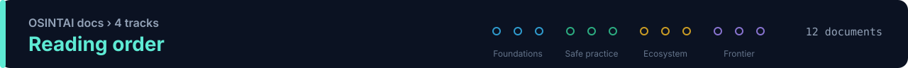

<!-- Generated by scripts/render.py — edit the sources, not this file. -->

[OSINTAI](../README.md) › **Docs**

# OSINTAI docs

12 guides in 4 tracks, about 32 minutes end to end. Read the tracks in order the first time; after that, jump straight to what you need.

## 🧱 Foundations

What the field is made of, how to build for it and how to learn it.

| # | Document | Read it when you want to… | Time |
|:---:|---|---|---:|
| 1 | **[Taxonomy](taxonomy.md)** | classify a tool by function, architecture, autonomy, deployment and security boundary | 4 min |
| 2 | **[Reference architecture](reference-architecture.md)** | design an evidence-first platform where AI is not the system of record | 3 min |
| 3 | **[Learning path](learning-path.md)** | progress from AI-assisted analysis to defensible agentic OSINT | 1 min |

## 🛡️ Safe practice

How to measure, constrain and govern AI-assisted investigation.

| # | Document | Read it when you want to… | Time |
|:---:|---|---|---:|
| 4 | **[Evaluation framework](evaluation-framework.md)** | compare systems on evidence quality and behavior, not screenshots | 2 min |
| 5 | **[MCP security](mcp-security.md)** | expose OSINT tools to assistants without widening the attack surface | 2 min |
| 6 | **[Governance](governance.md)** | apply purpose limitation, privacy and evidence integrity | 2 min |

## 🗺️ Ecosystem

What actually exists today, by role and trust level.

| # | Document | Read it when you want to… | Time |
|:---:|---|---|---:|
| 7 | **[Ecosystem map](ecosystem-v0.2.md)** | browse resources by investigative role and trust level | 3 min |
| 8 | **[Specialized domains](specialized-domains.md)** | understand trade-offs in dark web, SOCMINT, GEOINT and more | 1 min |
| 9 | **[Verification notes](verification-notes.md)** | see which claims were excluded and why | 6 min |

## 🔭 Frontier

Where practice is moving: new paradigms and new source classes.

| # | Document | Read it when you want to… | Time |
|:---:|---|---|---:|
| 10 | **[Paradigms](paradigms.md)** | follow the architectural shifts tracked since v0.3 | 4 min |
| 11 | **[Emerging intelligence sources](emerging-intelligence-sources.md)** | track new source classes such as PromptINT | 2 min |
| 12 | **[AI infrastructure OSINT](ai-infrastructure-osint.md)** | map publicly observable AI services defensively | 2 min |

---

Machine-readable data lives in [`catalog/`](../catalog/README.md) and is described by [`schemas/`](../schemas/README.md).
