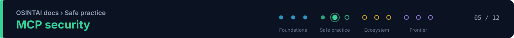

<!-- osintai:doc-header:start -->

[OSINTAI](../README.md) › [Docs](README.md) › 🛡️ **Safe practice** &nbsp;·&nbsp; about 2 min read
<!-- osintai:doc-header:end -->

# MCP for OSINT: Architecture and Security

Model Context Protocol can turn OSINT tools into reusable capabilities for AI assistants. That is powerful, but it also moves tool execution closer to untrusted natural-language inputs and retrieved content.

## Where MCP fits

~~~mermaid
flowchart LR
    U[Analyst] --> C[MCP Client / Agent]
    C --> S1[OSINT MCP Server]
    C --> S2[Public-data MCP Server]
    C --> S3[Internal MCP Server]
    S1 --> D1[APIs / Public Sources]
    S2 --> D2[Government / Open Data]
    S3 --> D3[Approved Internal Data]

    G[Policy / Allowlist] --- C
    L[Audit Log] --- C
    classDef ev fill:#0c4a6e,stroke:#38bdf8,color:#f0f9ff
    classDef mdl fill:#2e1065,stroke:#a78bfa,color:#f5f3ff
    classDef gate fill:#064e3b,stroke:#34d399,color:#ecfdf5
    classDef ctl fill:#422006,stroke:#fbbf24,color:#fffbeb
    classDef ext fill:#1e293b,stroke:#64748b,color:#f1f5f9
    class U gate
    class C mdl
    class S1,S2,S3 ev
    class D1,D2,D3 ext
    class G,L ctl
~~~

🟦 evidence &nbsp; 🟪 model / agent &nbsp; 🟩 human & verification &nbsp; 🟨 policy & scope &nbsp; ⬛ external sources

## Trust boundaries

Treat each MCP server as a software dependency with capabilities, not as a harmless plugin.

For every server record:
- maintainer;
- canonical repository;
- package source;
- version;
- tool list;
- required credentials;
- outbound network destinations;
- data sent to third parties;
- write or destructive capabilities;
- last review date.

## Minimum controls

### Tool allowlisting
Only expose tools required by the active case.

### Least privilege
A tool that only needs read access should not receive write or administrative credentials.

### Secret isolation
API keys should be injected by the runtime and never placed in model-visible prompts or evidence.

### Argument validation
Validate domains, URLs, identifiers, path values, enums, length and expected formats.

### Output treatment
Tool output is **untrusted content**. It may contain text crafted to manipulate the model.

### Prompt-injection resistance
Retrieved pages, documents and API text must not be treated as system instructions.

### Audit
Log:
- tool name and version;
- arguments with sensitive fields redacted;
- execution time;
- result status;
- case ID;
- requesting agent or task.

### Human gates
Require explicit review before:
- changing case scope;
- exporting sensitive case data;
- publishing a report;
- calling tools with material side effects.

## MCP catalog fields

OSINTAI tracks:
- protocol = MCP;
- runtime;
- tool count when verified;
- source classes;
- credentials;
- local or cloud behavior;
- verification status.

## Agentic threat model

Relevant threat classes include:
- agent goal hijacking;
- tool misuse;
- identity and privilege abuse;
- agentic supply-chain compromise;
- unexpected code execution;
- malicious memory;
- cascading failure between agents.

These should be tested in the evaluation harness rather than relegated to a disclaimer.

## Practical principle

> [!IMPORTANT]
> **A model should not automatically trust a tool merely because the tool arrived through a standard protocol.**

<!-- osintai:doc-footer:start -->
---

| ← Previous | | Next → |
|:---|:---:|---:|
| [Evaluation framework](evaluation-framework.md) | [📚 All docs](README.md) | [Governance](governance.md) |
<!-- osintai:doc-footer:end -->
